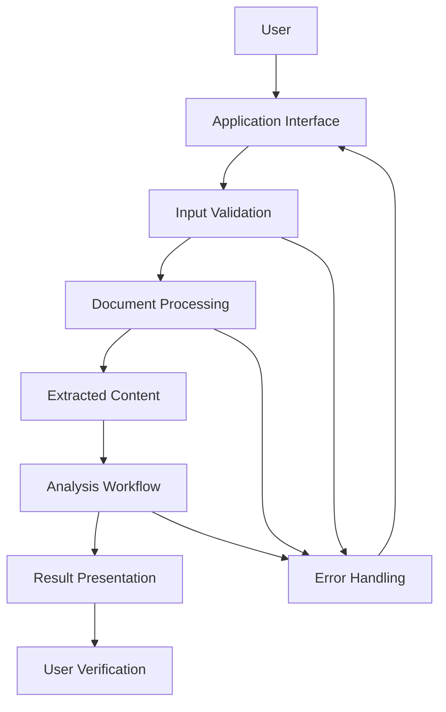
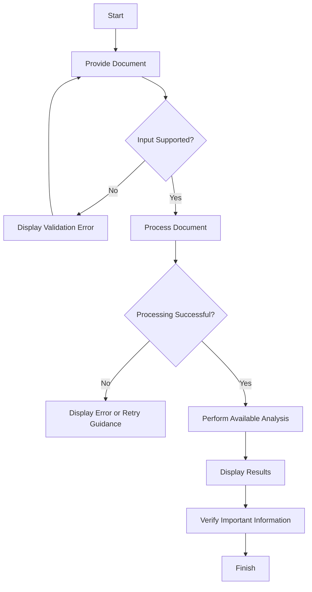
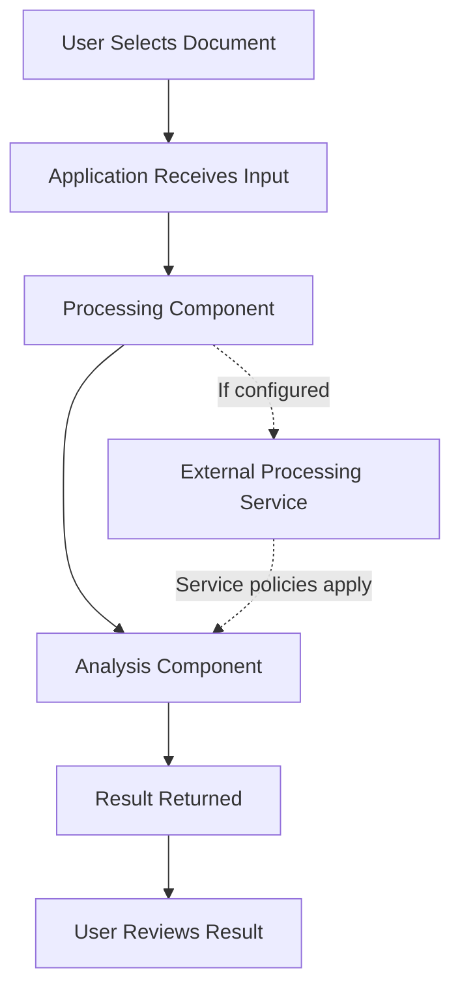

<p align="center">
  <strong>DocuLens</strong>
</p>

<p align="center">
  <a href="https://github.com/Devputta/DocuLens/blob/main/QR/qrforge_1024px%20(1).png">
    
  </a>
</p>

<p align="center">
  <strong>
    A document intelligence application designed to help users explore document
    content, organize information, and simplify document-based analysis through
    a structured workflow, with an emphasis on clarity, source verification,
    and responsible use.
  </strong>
</p>

<p align="center">
  <a href="https://github.com/Devputta/DocuLens">
    
  </a>
  
  
  
  
</p>

# DocuLens

**Document Intelligence, Structured Analysis, and Source-Grounded Answers**

DocuLens is a document-focused application designed to help users organize information from documents, understand their contents, and work with extracted information through a structured workflow.

The project aims to make document-based information easier to explore while emphasizing transparency, responsible use, and clarity about the limitations of automated analysis.

> **Project status:** Refer to the current source code and deployment for the implementation status of individual features. Planned functionality should not be presented as production-ready functionality.

---

## Table of Contents

- [Overview](#overview)
- [Problem Statement](#problem-statement)
- [Project Objectives](#project-objectives)
- [Key Features](#key-features)
- [How DocuLens Works](#how-doculens-works)
- [System Architecture](#system-architecture)
- [Core Workflow](#core-workflow)
- [Feature Documentation](#feature-documentation)
- [Technology Stack](#technology-stack)
- [Data Handling and Privacy](#data-handling-and-privacy)
- [Security Considerations](#security-considerations)
- [Responsible Use and Disclaimer](#responsible-use-and-disclaimer)
- [Limitations](#limitations)
- [Installation and Setup](#installation-and-setup)
- [Configuration](#configuration)
- [Development Workflow](#development-workflow)
- [Testing and Validation](#testing-and-validation)
- [Deployment](#deployment)
- [Project Structure](#project-structure)
- [Troubleshooting](#troubleshooting)
- [Roadmap](#roadmap)
- [Contributing](#contributing)
- [Security Reporting](#security-reporting)
- [License](#license)

---

## Overview

DocuLens explores a structured approach to document understanding by bringing document content and analysis into a single workflow.

Working with long documents can involve repeatedly searching for information, identifying relevant passages, comparing statements, and manually extracting important details. DocuLens is intended to reduce this effort by providing a more organized way to work with document content.

The project focuses on three principles:

1. **Clarity:** Present document information in a form that is easier to understand.
2. **Traceability:** Where source references are supported, help users identify the document content behind an answer.
3. **Responsible automation:** Make users aware that automated analysis can contain errors and requires verification.

DocuLens is a software project, not a guarantee that every extracted statement, generated answer, or interpretation is correct.

## Problem Statement

Document-heavy workflows can create several practical challenges:

- Important information may be distributed across many pages.
- Finding a specific statement can require repeated manual searches.
- Summarizing lengthy material takes time.
- Similar documents may contain different requirements, figures, or conclusions.
- Automated answers can be difficult to verify when their supporting sources are unclear.
- Sensitive information can be exposed if documents are handled without appropriate privacy controls.

DocuLens addresses these challenges through a document-oriented workflow. Its actual capabilities depend on the features implemented in the current version.

## Project Objectives

The primary objectives are to:

- Make document content easier to access and understand.
- Reduce repetitive manual information retrieval.
- Support a clear workflow from document input to useful output.
- Encourage verification against original source material.
- Explain privacy and security considerations in understandable language.
- Maintain documentation that helps users, developers, and contributors understand the system.
- Keep the project maintainable through modular implementation and documented development practices.

## Key Features

The following descriptions define the intended functionality of the project. Confirm each item against the current implementation before treating it as an available feature.

| Feature area | Purpose |
|---|---|
| Document input | Provide a way to supply supported documents to the application. |
| Content extraction | Make readable document content available for subsequent processing. |
| Document analysis | Help users examine and understand extracted information. |
| Question answering | Support questions about document content if an answering workflow is implemented. |
| Source references | Help users verify answers against original passages when citation support is implemented. |
| Document comparison | Help identify similarities or differences when comparison functionality is available. |
| Error handling | Communicate unsupported files, invalid inputs, or processing failures. |
| Privacy awareness | Explain the implications of uploading and processing documents. |
| Developer documentation | Describe setup, architecture, configuration, testing, and maintenance. |

**Important:** Do not advertise document formats, OCR, authentication, persistent storage, comparison tools, export options, or AI providers unless they are supported by the actual code.

## How DocuLens Works

At a conceptual level, a document-analysis application can be organized into the following stages:

1. **Input:** The user supplies a supported document or selects an available document.
2. **Validation:** The application checks whether the input can be processed.
3. **Extraction:** Text or other supported content is extracted.
4. **Processing:** The extracted content is prepared for the implemented analysis workflow.
5. **Analysis:** The application performs the requested operation using its configured processing components.
6. **Presentation:** The result is displayed to the user.
7. **Verification:** The user checks important statements against the original document.

Some stages may be combined, implemented differently, or unavailable in a particular release.

## System Architecture

The architecture below is a **conceptual reference diagram**, not a verified representation of every component currently present in the repository.



### Architecture components

**Application interface**

Provides the user-facing controls for submitting inputs, initiating supported operations, and viewing results.

**Input validation**

Checks input requirements before processing. The specific validation rules depend on the implemented file-handling and application logic.

**Document processing**

Handles the supported method of reading or extracting document content.

**Analysis workflow**

Performs the analysis available in the application. If an external AI service is used, its behavior, data handling, and limitations must be documented separately.

**Result presentation**

Displays the output in a form users can review and compare with the original document.

**Error handling**

Helps the application respond to invalid inputs, unsupported documents, unavailable services, and processing errors.

## Core Workflow



The diagram describes the intended user journey. Actual processing behavior should be confirmed using the application.

## Feature Documentation

### 1. Document Input

**Purpose:** Provide a starting point for document-based workflows.

A document input feature should clearly communicate which file formats are supported, any size restrictions, and whether the document is processed locally or transmitted to an external service.

Expected documentation should explain:

- Supported file formats.
- Maximum permitted file size, if applicable.
- Input validation behavior.
- What happens when a file is rejected.
- Whether the original file is retained.
- Whether uploaded content is sent to another service.

Do not assume all these controls exist merely because the interface accepts a file.

### 2. Content Extraction

**Purpose:** Make document content available for analysis.

Extraction quality can depend on file structure, text encoding, layout, tables, scanned pages, and document complexity.

If extraction fails, the application should communicate the issue rather than silently presenting incomplete information as complete.

OCR should be documented only if optical character recognition is implemented.

### 3. Document Analysis

**Purpose:** Help users examine the contents of supported documents.

Depending on the implemented workflow, analysis may involve locating information, organizing extracted content, or producing a summary.

Automated analysis can omit context, misinterpret wording, or overlook information. Important conclusions should therefore be checked against the original document.

### 4. Question Answering

**Purpose:** Allow users to ask questions about document content, if this capability exists in the current release.

A reliable implementation should make it clear whether an answer is based on the supplied document, general model knowledge, or a combination of sources.

Where source-grounded answering is implemented, the application should avoid presenting unsupported claims as though they were explicitly stated in the document.

### 5. Source References and Citations

**Purpose:** Make it easier to verify answers against their source material, where citation support exists.

Useful source references may include page numbers, quoted passages, section names, or links to relevant document locations.

A citation is not automatically proof that an answer is correct. Users should confirm that the referenced passage actually supports the statement.

If the current implementation does not provide source references, this feature should be marked as planned rather than available.

### 6. Document Comparison

**Purpose:** Help users examine differences between multiple documents, if comparison functionality is implemented.

Comparison results may be affected by formatting changes, document versions, missing sections, or differences in extraction quality.

Users should review the original documents before relying on a comparison for contractual, financial, compliance, or other important decisions.

### 7. Error Handling

**Purpose:** Make failures understandable and recoverable.

Examples of errors worth documenting include:

- Unsupported file type.
- Empty or unreadable document.
- File exceeding an enforced limit.
- Extraction failure.
- External service timeout.
- Invalid configuration.
- Network or dependency failure.

Error messages should explain the problem without exposing secrets, credentials, internal system details, or sensitive document contents.

---

## Technology Stack

The authoritative technology stack is the one declared in the repository's source files and dependency manifests.

Review the relevant files before completing this table.

| Component | Technology |
|---|---|
| User interface | Confirm from the application source |
| Application logic | Confirm from the source and project configuration |
| Document processing | Confirm from installed dependencies |
| AI or analysis provider | Confirm from implementation and configuration |
| Storage | Confirm whether local, remote, or persistent storage is implemented |
| Testing | Confirm from test files and scripts |
| Deployment | Confirm from deployment configuration |

This table intentionally avoids naming technologies that may not be part of the current implementation.

## Data Handling and Privacy

Documents may contain personal, confidential, commercial, financial, legal, or otherwise sensitive information. Users should understand how their information is handled before submitting it.

### Data-flow considerations



This is an illustrative diagram. It does not establish that the application uses an external service or that data follows any particular storage or transmission path.

### Questions users should be able to answer

- Is the document processed locally or by an external provider?
- Is the original file saved?
- Is extracted text stored after processing?
- Are prompts or results retained?
- Are application logs generated?
- Can documents be accessed by other users?
- How can users remove retained information?
- What retention policies apply to any external provider?

The answers must come from the implementation, deployment configuration, and applicable provider policies.

### Privacy principles

- Submit only documents you are authorized to process.
- Avoid uploading unnecessary personal or confidential information.
- Use appropriate access controls for deployed instances.
- Do not expose private documents through public URLs or repositories.
- Review third-party service policies before transmitting document content.
- Avoid retaining document data longer than required.
- Do not claim that data is never stored or shared unless that claim has been verified.

## Security Considerations

Security depends on both application code and deployment configuration. The following are recommended review areas, not claims that every control is already implemented.

### Input validation

Validate uploaded content and enforce reasonable limits. Do not rely solely on a filename or browser-provided MIME type to establish that a file is safe.

### Secrets management

Store API keys, tokens, passwords, and other credentials outside source control. Use environment variables or the hosting platform's secret-management facility where appropriate.

Never publish real credentials in README files, source code, screenshots, logs, or issue reports.

### File handling

Review temporary-file handling, file permissions, filename normalization, storage locations, and cleanup behavior.

### External services

If the application sends data to third-party services, document what is transmitted and review the provider's security and privacy practices.

### Error messages and logs

Prevent logs and user-facing errors from exposing credentials, private document contents, or sensitive implementation details.

### Dependencies

Keep dependencies updated where practical, review security advisories, and investigate unexpected dependency changes.

### Deployment

Use HTTPS for public deployments, restrict access to administrative functions, and verify that production configuration does not expose development services or debugging information.

## Responsible Use and Disclaimer

DocuLens is intended to assist with document-oriented information retrieval and analysis. It should not replace careful reading, independent verification, or qualified professional judgment.

### Accuracy disclaimer

Automated extraction and analysis can produce incomplete, outdated, misleading, or incorrect results. Formatting, scanned content, ambiguous language, and missing context may affect output quality.

Verify important information against the original document.

### Professional advice disclaimer

Unless a specific implementation has been assessed and approved for the relevant purpose, do not treat DocuLens as a substitute for qualified legal, medical, financial, tax, compliance, or other professional advice.

### Confidentiality disclaimer

Users are responsible for ensuring that they have permission to submit and process their documents. Do not upload sensitive information until the application's data-handling behavior is understood.

### Third-party services disclaimer

If external APIs or providers are used, their availability, pricing, terms, privacy policies, and processing behavior may affect the application. Those services are subject to their own conditions.

### No guarantee

The project documentation does not guarantee uninterrupted availability, error-free analysis, complete extraction, or suitability for a particular purpose.

## Limitations

Potential limitations of document-analysis systems include:

- Unsupported document formats.
- Poor-quality or scanned documents.
- Incorrect extraction of tables and complex layouts.
- Loss of context when working with lengthy documents.
- Inaccurate summaries or generated answers.
- Incomplete source references.
- External API rate limits, costs, or service interruptions.
- Performance constraints for large documents.
- Privacy and retention requirements that depend on deployment configuration.

These are general considerations. The limitations that actually apply to a particular release should be tested and documented explicitly.

## Installation and Setup

Use the following steps as a general development workflow. Confirm the actual commands against the repository's `package.json`, lockfile, dependency files, and project documentation.

### Prerequisites

- Git.
- The runtime required by the project.
- A package manager compatible with the repository's lockfile.
- Any required environment variables or external service credentials.

### 1. Clone the repository

```bash
git clone https://github.com/Devputta/DocuLens.git
cd DocuLens
```

### 2. Install dependencies

For an npm-based project:

```bash
npm install
```

Use the package manager and installation command specified by the repository if it differs.

### 3. Configure environment variables

Review the project's environment-variable examples and configuration files. Create a local environment file only if the application expects one.

Do not commit secrets or production credentials.

### 4. Start the development server

For a project that defines the standard development script:

```bash
npm run dev
```

If the project uses another command, follow the script defined in its package configuration.

### 5. Build the application

For a project that defines a build script:

```bash
npm run build
```

A successful build does not by itself prove that every feature works correctly.

## Configuration

Configuration requirements depend on the current implementation.

Document each required setting using the following structure:

| Setting | Purpose | Required? |
|---|---|---|
| Application environment | Selects development or production behavior, if supported | Verify |
| API credentials | Authorizes an external service, if used | Verify |
| Service endpoint | Identifies a configured backend or provider, if used | Verify |
| Upload limits | Controls permitted input size, if configurable | Verify |
| Storage configuration | Defines storage behavior, if implemented | Verify |

For every real setting, explain where it is configured, whether it is required, and how to obtain its value safely.

Do not include live secret values in documentation.

## Development Workflow

A recommended development workflow is:

1. Review the existing architecture and implementation.
2. Identify the relevant module before making changes.
3. Confirm the expected behavior and acceptance criteria.
4. Implement the smallest maintainable change.
5. Run applicable tests and build checks.
6. Test success, failure, and boundary cases.
7. Update documentation when behavior or configuration changes.
8. Review the final changes before submitting a commit.

Keep documentation consistent with the actual application. Remove references to features that have been discontinued or are not yet implemented.

## Testing and Validation

Testing should cover both expected behavior and failure conditions.

Recommended areas include:

- Application startup.
- Valid and invalid input.
- Supported and unsupported file types.
- Empty and unusually large documents.
- Extraction and analysis failures.
- Missing or invalid configuration.
- External service errors, if applicable.
- Privacy-sensitive logging.
- Responsive interface behavior.
- Production build and deployment configuration.

Use the test commands defined in the repository. Do not claim a test has passed unless it has actually been executed successfully.

## Deployment

The deployment procedure depends on the framework, build output, backend requirements, and hosting provider.

Before deploying:

1. Confirm the production build succeeds.
2. Configure required environment variables through the hosting provider.
3. Ensure secrets are not included in public assets or source control.
4. Confirm that required backend services are available.
5. Verify upload handling and error responses.
6. Review access controls and data retention.
7. Test the deployed application with non-sensitive sample documents.
8. Document any provider-specific requirements.

A public website being accessible does not establish that all workflows, security controls, or privacy guarantees have been verified.

## Project Structure

The following is a conceptual organization. It is not a verified file tree of the current repository.

```text
DocuLens/
├── README.md
├── LICENSE
├── SECURITY.md
├── docs/
│   ├── requirements.md
│   ├── architecture.md
│   ├── user-guide.md
│   ├── privacy.md
│   ├── security.md
│   └── deployment.md
├── src/
│   ├── application/
│   ├── components/
│   ├── services/
│   └── utilities/
├── tests/
├── public/
└── package.json
```

Use the actual directory structure when documenting implementation-specific modules. Do not create references to files that do not exist.

## Troubleshooting

### Dependency installation fails

- Confirm the required runtime and package-manager versions.
- Use the package manager matching the repository's lockfile.
- Review the complete dependency error before changing package versions.
- Avoid deleting lockfiles as a first troubleshooting step.

### The application does not start

- Confirm dependencies installed successfully.
- Check the command defined in the project configuration.
- Review terminal output for missing environment variables or configuration.
- Confirm that required services are available.

### A document cannot be processed

- Verify that the format is supported.
- Check the file size and integrity.
- Try a non-sensitive sample document.
- Review application logs without exposing confidential content.

### Analysis fails

- Confirm that the relevant feature is implemented and configured.
- Check external service availability if the application uses one.
- Verify required credentials without printing them in logs.
- Review timeout and rate-limit errors.

### The deployed version behaves differently

- Compare local and production environment variables.
- Confirm the deployed build corresponds to the intended commit.
- Review hosting logs and service configuration.
- Verify that the correct frontend and backend versions are deployed.

## Roadmap

The following items are possible future improvements, not commitments or claims of existing functionality.

- Improve extraction quality for supported document types.
- Strengthen source-reference presentation and verification.
- Expand automated tests for document-processing edge cases.
- Improve user-facing error messages.
- Document privacy and data-retention behavior more precisely.
- Improve accessibility and responsive layouts.
- Add maintainable architecture and workflow diagrams.
- Improve deployment guidance and operational checks.

Prioritize roadmap items based on actual user needs, technical feasibility, and project direction.

## Contributing

Contributions that improve correctness, usability, security, accessibility, and documentation are welcome, subject to the repository's contribution process.

### Suggested contribution process

1. Review the existing code and documentation.
2. Identify a specific issue or improvement.
3. Discuss substantial changes before implementing them.
4. Create a focused branch.
5. Make changes that follow the project's existing conventions.
6. Run relevant tests and build checks.
7. Update documentation where necessary.
8. Submit a pull request explaining the change and its validation.

### Contribution guidelines

- Keep changes focused and maintainable.
- Avoid adding dependencies without a clear reason.
- Do not commit secrets, private documents, or sensitive logs.
- Do not make unsupported privacy or security claims.
- Clearly distinguish implemented features from planned functionality.
- Include reproduction steps for bug reports where possible.

## Security Reporting

If you discover a potential security vulnerability, avoid publishing exploit details, credentials, private documents, or other sensitive information in a public issue.

Review the repository's `SECURITY.md` for the supported reporting process. If no private reporting channel is documented, contact the maintainer through an appropriate private channel before disclosing sensitive details publicly.

Please include enough information to reproduce the issue safely, along with the affected component and relevant version information.

## License

The project's licensing terms are determined by the `LICENSE` file in the repository.

If a license file is present, review it before copying, modifying, distributing, or incorporating the project into another product. If no license has been selected, clarify the intended license before claiming that the project is open source.

---

## Project Links

- **Repository:** https://github.com/Devputta/DocuLens
- **Issues and improvements:** Use the repository's Issues section where appropriate.
- **Documentation:** Refer to the documentation files included in the repository.

## Final Note

DocuLens is intended to make working with document information more structured and understandable. Its reliability depends on the quality of the source documents, the implemented processing workflow, the configuration of any external services, and the user's verification of important results.

**Build transparently. Document accurately. Verify important information.**

<p align="center">  <a href="https://github.com/Devputta/Drafts-might-be-needed-/blob/main/LOGO/Gemini_Generated_Image_1ppnm1ppnm1ppnm1%20(1).jfif" target="_blank" rel="noopener noreferrer">      </a></p>


---

<p align="center">
  <strong>DocuLensLink</strong>
  <br />
  Private by design. Ephemeral by default.
</p>

